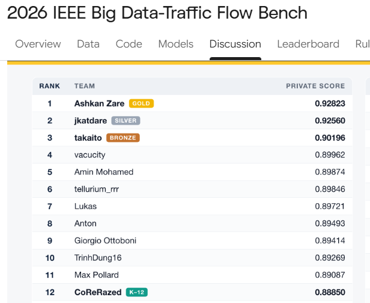

# TrafficFlowBench 2026 — 4th Place Solution (team *vacucity*)

Team *vacucity* finished **4th on the private leaderboard** of the 2026 IEEE Big Data Cup *TrafficFlowBench*
(Kaggle), with a private score of **0.89962**.



## Final submission

| submission | private LB | public LB |
|---|---|---|
| **V86** (`V86_spacetime_guard.zip`) | **0.89962** (4th) | 0.90359 |

This repository rebuilds V86 from the official data release and the trained models shipped here, as
`work/submissions/v86_spacetime_guard.zip` (submitted file SHA-256
`9e1ba0523c88b6ad70aeccf95c41e64a3c1639558c9c4a555867c75fc7cf1867`). Scores are from the Kaggle submission page.

## Solution overview

* **Task 1** (masked speed / flow / density cells): LightGBM residual models and two month-adapted whole-day U-Nets,
  blended and stacked, followed by a chain of calibration stages (per-month bias, blackout-gap specialists, congested
  density, speed common mode, late residual corrections). Task 3 is scored from the Task 1 output.
* **Task 2** (queue prediction per window): an ensemble of LightGBM, CatBoost, CNN and BiLSTM members with
  selection-rule conditioning; the April members are fine-tuned on the validation month (March).
* **Task 4**: the official NNLS reference (the pipeline rebuilds it with the organisers' builder and checks it
  against the shipped copy).
* **Final step:** the model chain ends in V84. V86 is V84 with 94 Task 2 queue cells flipped by a spatio-temporal
  queue guard (no model is retrained); every other value equals V84's. The guard's decisions ship as a frozen change
  list, its code is not included (report, disclosure 6).

The method, its validation and all compliance disclosures are in the report: [`report/main.pdf`](report/main.pdf).

## Quick start

Tested only on Windows 11 with an RTX 4070 Laptop GPU (8 GB), Python 3.11.5; about 58 GB of free disk.

```
conda create -n tfb python=3.11.5
conda activate tfb
pip install -r work/requirements.txt --extra-index-url https://download.pytorch.org/whl/cu121
```

Download the official release from the competition's Data tab and unzip it as `kaggle_public/` next to `work/`.
Then, from the repository root:

```
python work/run_all.py --plan                 # list all 36 stages
python work/run_all.py --run-all              # full rebuild, about 18 h on our machine
python work/run_all.py --run-all --tolerant   # use this on any other GPU model
python work/run_all.py --run verify           # compare the rebuilt V86 with the submitted file
```

A stopped run continues with `--resume`. On a different GPU model, bf16 kernels can flip a few Task 2 cells;
`--tolerant` reports such differences instead of stopping.

**Verified:** a clean copy of this package ran all 36 stages from the official release and rebuilt V86
content-identical to the submitted file (only the line endings of 521 lines differ, so the SHA-256 differs).

Full details (stage by stage, verification, random seeds, licenses) are in [REPRODUCTION.md](REPRODUCTION.md).

## Repository layout

```
README.md                       <- this overview
REPRODUCTION.md                 <- full reproduction notes
MANIFEST.json                   <- size and SHA-256 of every shipped file
report/main.pdf                 <- method, validation and compliance disclosures
report/leaderboard.png          <- private leaderboard screenshot
work/                           <- code, trained models, frozen decision files, run_all.py
trafficflowbench-public-main/   <- the organisers' Task 4 builder (shipped subset)
```

## Data and licenses

* Only the official TrafficFlowBench release was used: no external data, no pretrained models from outside the
  project, no APIs.
* Our code is released under the MIT License (`LICENSE`). The shipped models and other files derived from the release
  are provided only to verify our submission and remain subject to the Competition Rules.
* `trafficflowbench-public-main/` is a subset of the organisers' public repository
  (https://github.com/jacky850/trafficflowbench-public, MIT License).

## Team

Team *vacucity* (Kaggle team "vacucity"):

* Chujie Wang (Kaggle wcj030728), The University of Chicago
* Jiayu Liu (Kaggle lazywhale110), Tianjin University
* Feiyan Fu (Kaggle feiyanfu), Linkerbot Beijing Technology Co., Ltd.
* Ao Li (Kaggle mixriaoliao), Fuzhou University of International Studies and Trade

Contact: Chujie Wang, chujiewang424@gmail.com
